A modern IT company building scalable, high-performance applications.
We leverage diverse technology stacks to deliver robust solutions for clients globally.

---

## Core Competencies

- **Frontend Development** - responsive, accessible, highly interactive interfaces with React and Vue
- **Backend Architecture** - scalable microservices and robust APIs with Node.js, Python or Go
- **UI/UX Design** - user-centric digital experiences that drive engagement

## Technologies we master

  

## Projects

| Project | What it is |
|---|---|
| [shard.team](https://github.com/shard-src/shard.team) | This website: multilingual company site (EN/RU/KZ) |
| [qazaqstan.world](https://github.com/shard-src/qazaqstan.world) | Republic of Kazakhstan: statistics, flag, emblem, anthem and lyrics. Terminal edition |

## Contact

Start a project via the [contact form](https://shard.team) on our site.
